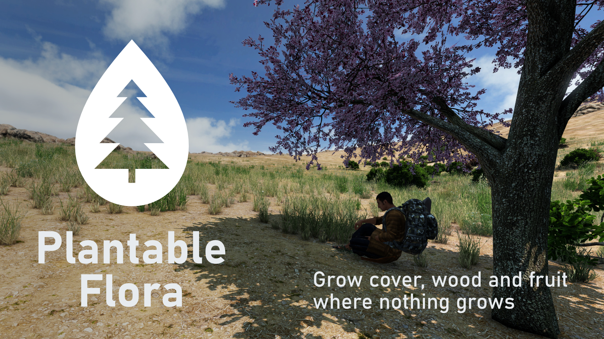

# PlantableFlora - Plant Trees and Bushes for DayZ

Players dig a planting hole, water it and plant tree and bush seeds they find in the world. A small seedling grows over hours into a real map tree or bush: hide a base, grow cover, start an orchard. Planted plants look exactly like the wild ones.

**Steam Workshop:** not published yet.  
**Feedback, bugs, ideas:** [GitHub issues](https://github.com/olliollio/PlantableFlora/issues)

## What it does

- **Seeds** come from loot, from searching wild trees ("Search for seeds", 0-3 seeds), from cutting wild bushes and from fruit ("Get seeds" with a knife). Grown planted trees give seeds and fruit too.
- **Planting** needs a hole dug with a shovel (60 cm soil heap) and water; fertilizer (garden lime, plant material) makes plants grow faster. An empty vanilla garden plot works too.
- **Growth:** seedling → young → full-grown, real time (default: bushes 1 h, trees 12 h). Fully grown trees can be felled (logs, sticks, stump), bushes cut (sticks, they grow back) or dug up.
- **Maps:** Chernarus and Livonia (16 trees + forest variants, 6 bushes), Badlands with its own species (fig, Turkish pine, olive, date palm, poplar, ash, plum; oleander, fig bush, prickly pear, cycas, Syrian rue) and its own soil look: cover, wood and fruit where almost nothing grows. Seeds only grow on their own map. Frostline works with the Chernarus species.
- **Fair play:** no planting in other players' bases, near roads or buildings, in caves or admin no-plant zones; no trees on stashes (a bush on top hides a stash). Limits per player (inside / outside the own base), per base and per server. Plants outside a base decay like base building.
- **Not recognizable:** planted trees have no name and offer the same actions as wild ones.
- Fully configurable by server admins through `config.json`.

## Documentation

| Guide | For |
|---|---|
| [Roadmap](ROADMAP.md) | What may come next (real shade on Badlands, map mods, Frostline look, …) |
| [Admin guide](docs/ADMIN.md) | Server owners: install, loot, species per map, `config.json`, every setting, presets |
| [Tester guide](docs/TESTER.md) | Testers: what to try |

## Install (server owners)

1. Subscribe to the Workshop item and add the mod to the `-mod=` list of the server **and** the clients.
2. Copy `keys/PlantableFlora.bikey` from the mod into the server's `keys` folder.
3. Add the seed loot from the mod's `ServerFiles` folder to your mission's `db/types.xml`: `types_PlantableFlora.xml` (Chernarus, Livonia, other maps) or `types_PlantableFlora_nasdara.xml` (Badlands).
4. Start the server once. It creates `profiles/PlantableFlora/config.json` with the defaults. Edit it and restart. See the [admin guide](docs/ADMIN.md).

## Status

Test build (0.1.0). See [CHANGELOG.md](CHANGELOG.md) and the [roadmap](ROADMAP.md).

## Repository layout

| Path | Content |
|---|---|
| `PlantableFlora_starter/PlantableFlora` | Mod source (config, scripts, models, textures). The seedling and planting hole models are only in the packed mod (licence), so this source does not build a complete mod on its own |
| `release/` | `mod.cpp` and launcher images of the Workshop folder |
| `server_files/` | Seed loot (`types.xml` entries) per map |
| `docs/` | Guides |
| `Artwork/` | Logo and Workshop screenshots |

## Credits and licence

Seedling model: "Seedling in soil Vol. 257" (CGTrader, royalty-free licence), reduced and converted for DayZ. The model is not part of the public repository.

Code and docs: MIT ([LICENSE](LICENSE)). The seedling model and its textures are excluded: they may only be used as part of this mod.
